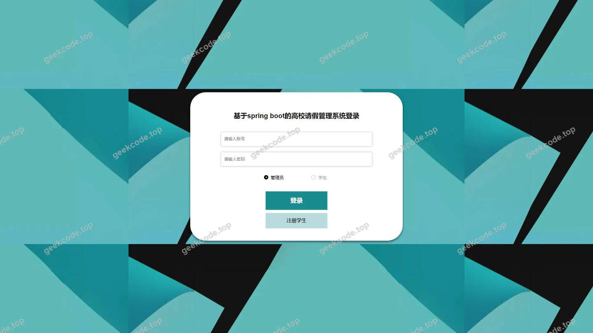
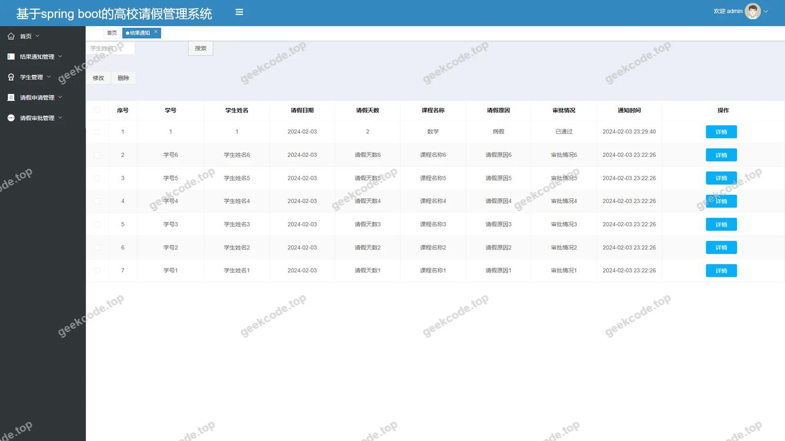
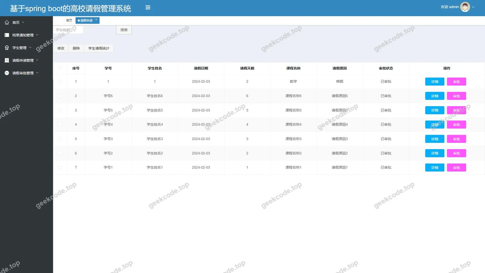
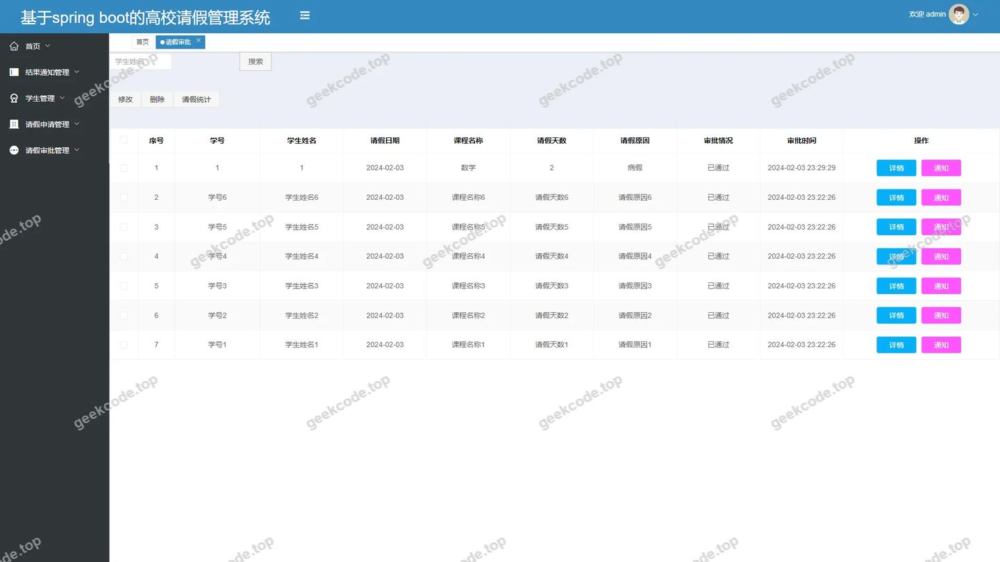
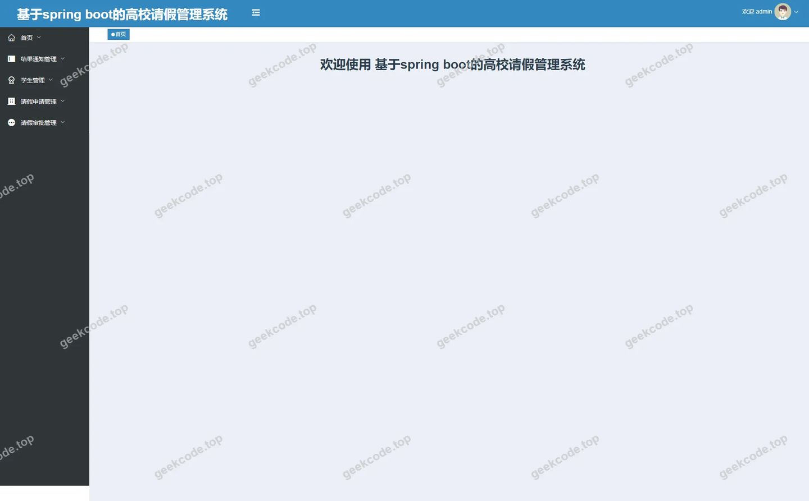
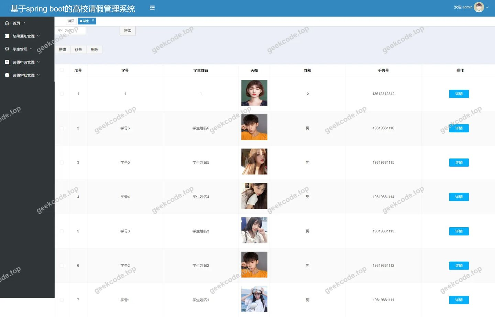

# 基于spring boot的高校请假管理系统

> 🎓 **计算机毕业设计 · 基于spring boot的高校请假管理系统**
>
> 本仓库只放**项目介绍 + 运行截图**（截图是站点带水印的原图，存在仓库 `images/` 里）。
>
> 👉 **完整可运行源码 / 数据库脚本 / 部署文档：[点我获取](https://geekcode.top/archives/%E5%9F%BA%E4%BA%8Espring-boot%E7%9A%84%E9%AB%98%E6%A0%A1%E8%AF%B7%E5%81%87%E7%AE%A1%E7%90%86%E7%B3%BB%E7%BB%9F?utm_source=github)**
>
> 💬 咨询微信：**ir9372**　|　🌐 更多项目：[极客代码 geekcode.top](https://geekcode.top/?utm_source=github)
>
> 📌 项目详情页：<https://geekcode.top/archives/%E5%9F%BA%E4%BA%8Espring-boot%E7%9A%84%E9%AB%98%E6%A0%A1%E8%AF%B7%E5%81%87%E7%AE%A1%E7%90%86%E7%B3%BB%E7%BB%9F?utm_source=github>

<table><td width="230" align="center"> <b>扫码加微信 ir9372</b></td><td valign="middle">📦 源码 = 项目介绍 + 全部运行截图 + 数据库 + 部署文档 👉 点上方任意截图，直接跳到 <b>极客代码 geekcode.top</b> 详情页</td></table>

---

<h1>基于spring boot的高校请假管理系统</h1>
<h2>项目概述</h2>

本项目名为“基于 Spring Boot 的高校请假管理系统”，旨在解决高校学生日常请假流程繁琐、审批效率低下及信息传递不及时的问题。系统采用前后端分离架构，核心功能涵盖学生在线提交请假申请、教师或管理员进行审批处理以及最终结果通知的闭环管理。适用人群主要包括高校在校学生、负责审批的教师/辅导员以及系统管理员。技术架构上，后端基于 Spring Boot 框架，集成 MyBatis-Plus 进行数据持久化操作，使用 Apache Shiro 实现安全认证与权限控制；前端界面通过 Vue 构建，提供直观的操作体验。该系统实现了请假业务的数字化管理，提升了校园行政管理的透明度与效率。

<h2>技术架构</h2>
<h3>1. 整体架构设计</h3>

系统采用典型的 B/S（Browser/Server）架构模式，分为表现层、业务逻辑层和数据访问层。

<ul>
<li><strong>表现层</strong>：由 Vue.js 构建的前端应用组成，负责用户交互界面的渲染与数据展示。根据路由配置，包含学生中心、请假申请、请假审批、结果通知及学生管理等模块页面。</li>
<li><strong>业务逻辑层</strong>：基于 Spring Boot 框架开发，利用其自动配置和起步依赖特性快速搭建服务接口。引入 Apache Shiro 作为安全管理框架，负责身份验证（Authentication）、授权（Authorization）以及会话管理，确保不同角色只能访问其权限范围内的资源。</li>
<li><strong>数据访问层</strong>：采用 MyBatis-Plus 作为 ORM 框架，简化了单表 CRUD 操作，并通过 <code>mybatis-spring-boot-starter</code> 与 Spring Boot 无缝集成。底层数据库选用 MySQL，通过 <code>mysql-connector-java</code> 驱动连接。</li>
</ul>
<h3>2. 核心技术选型理由</h3>
<ul>
<li><strong>Spring Boot</strong>：作为主流 Java 企业级开发框架，具备约定优于配置的特点，能快速构建独立运行的微服务或单体应用，生态丰富且社区支持强大。</li>
<li><strong>MyBatis-Plus</strong>：在 MyBatis 基础上增强，提供了通用的 CRUD 接口和条件构造器，大幅减少了样板代码，提高了开发效率，同时保留了 SQL 执行的灵活性。</li>
<li><strong>Apache Shiro</strong>：相比 Spring Security，Shiro 更轻量且易于理解，特别适合中小型项目的安全需求。它能有效管理用户登录状态及细粒度的权限控制，保障系统安全性。</li>
<li><strong>Vue.js</strong>：渐进式 JavaScript 框架，组件化开发模式使得前端代码结构清晰、易于维护，配合路由机制实现单页应用（SPA）的良好用户体验。</li>
</ul>
<h3>3. 数据库设计要点</h3>

虽然未提供具体表结构截图，但根据功能模块推断，数据库主要实体包括：

<ul>
<li><strong>学生信息表</strong>：存储学生基本档案、账号密码等。</li>
<li><strong>请假申请表</strong>：记录请假类型、起止时间、事由、申请人ID及当前状态。</li>
<li><strong>审批记录表</strong>：关联请假申请，记录审批人意见、审批时间及结果。</li>
<li><strong>通知消息表</strong>：用于向相关用户推送审批结果或系统公告。
数据交互通过 RESTful API 完成，遵循 JSON 格式传输标准。</li>
</ul>
<h2>功能模块</h2>

根据提供的后台路由 <code>/xueshengCenter</code>, <code>/qingjiashenpi</code>, <code>/qingjiashenqing</code>, <code>/jieguotongzhi</code>, <code>/xuesheng</code>, <code>/xueshengRegister</code> 及截图功能列表，系统主要划分为以下模块：

<h3>1. 后台管理端功能</h3>

后台是系统的核心操作区域，主要面向管理员及具有特定权限的用户（如教师/辅导员）。

<ul>
<li>
<strong>登录与安全模块</strong>

</li>
<li>
<strong>功能描述</strong>：提供统一的用户身份认证入口。通过 Shiro 框架校验用户名和密码，验证通过后建立会话并跳转至对应角色的主页。

</li>
<li>
<strong>涉及路由</strong>：默认登录页（Admin Login）。

</li>
<li>
<strong>学生管理中心 (<code>/xuesheng</code>, <code>/xueshengRegister</code>)</strong>

</li>
<li>
<strong>功能描述</strong>：

</li>
<li>
<strong>学生注册</strong>：允许新学生录入基本信息并创建账号。

</li>
<li>
<strong>学生信息管理</strong>：管理员可查看、编辑或删除学生档案，维护基础数据完整性。

</li>
<li>
<strong>涉及路由</strong>：<code>/xueshengRegister</code> (注册), <code>/xuesheng</code> (列表/管理)。

</li>
<li>
<strong>请假申请管理 (<code>/qingjiashenqing</code>)</strong>

</li>
<li>
<strong>功能描述</strong>：查看全校或管辖范围内的所有请假申请记录。支持按状态（待审批、已批准、已驳回）筛选，便于管理者全局监控请假情况。

</li>
<li>
<strong>涉及路由</strong>：<code>/qingjiashenqing</code>。

</li>
<li>
<strong>请假审批处理 (<code>/qingjiashenpi</code>)</strong>

</li>
<li>
<strong>功能描述</strong>：针对处于“待审批”状态的请假单进行操作。审批人可以填写审批意见，选择“同意”或“拒绝”。此模块直接关联业务流程的核心环节。

</li>
<li>
<strong>涉及路由</strong>：<code>/qingjiashenpi</code>。

</li>
<li>
<strong>结果通知管理 (<code>/jieguotongzhi</code>)</strong>

</li>
<li>
<strong>功能描述</strong>：生成并发送审批结果通知。当审批完成后，系统在此模块记录通知详情，确保学生能及时知晓请假状态变更。

</li>
<li>
<strong>涉及路由</strong>：<code>/jieguotongzhi</code>。

</li>
<li>
<strong>学生个人中心 (<code>/xueshengCenter</code>)</strong>

</li>
<li>
<strong>功能描述</strong>：学生登录后的专属视图。在此页面，学生可以发起新的请假申请、查询自己的历史申请记录以及接收审批结果通知。

</li>
<li>
<strong>涉及路由</strong>：<code>/xueshengCenter</code>。

</li>
</ul>
<h3>2. 前台用户端功能</h3>

根据上下文，“是否有前台: 是”但“无前台导航菜单”及“无前台路由”，结合截图均为 <code>(admin)</code> 标识，推测所谓“前台”实指面向最终用户（学生）的操作界面，而非独立的公共门户网站。学生的操作主要通过上述“学生个人中心”及“请假申请”等路由完成，这些界面虽在后台系统中定义，但服务于普通用户视角的业务流程。

<h2>用户角色与权限</h2>

系统基于 Apache Shiro 实现角色划分与权限控制，主要涉及两类核心角色：

<h3>1. 系统管理员 / 审批人员</h3>

此类角色拥有较高的系统权限，负责数据的维护和业务流的管控。

<ul>
<li><strong>可访问功能模块</strong>：</li>
<li><strong>后台首页</strong>：查看系统概览。</li>
<li><strong>学生管理</strong>：执行 <code>/xuesheng</code> 路由下的增删改查操作，管理用户账号。</li>
<li><strong>请假审批</strong>：执行 <code>/qingjiashenpi</code> 路由，对提交的请假单进行审核决策。</li>
<li><strong>请假申请查看</strong>：执行 <code>/qingjiashenqing</code> 路由，查看所有申请记录。</li>
<li><strong>结果通知</strong>：执行 <code>/jieguotongzhi</code> 路由，管理通知发送记录。</li>
<li><strong>用户注册审核</strong>：间接参与 <code>/xueshengRegister</code> 产生的新用户数据管理。</li>
</ul>
<h3>2. 学生用户</h3>

此类角色为系统的普通使用者，权限仅限于个人业务数据。

<ul>
<li><strong>可访问功能模块</strong>：</li>
<li><strong>学生个人中心</strong>：访问 <code>/xueshengCenter</code>，查看个人信息。</li>
<li><strong>请假申请提交</strong>：通过 <code>/qingjiashenqing</code> 的相关子功能或表单，提交新的请假请求。</li>
<li><strong>结果查询</strong>：在个人中心或通知列表中查看自己申请的审批结果。</li>
<li><strong>自主注册</strong>：访问 <code>/xueshengRegister</code> 完成初始账号创建。</li>
<li><strong>权限限制</strong>：无法访问其他学生的隐私数据，无权进行审批操作，无法进入纯管理性质的后台菜单（如全量学生管理）。</li>
</ul>
<h2>项目特色与创新点</h2>
<ol>
<li>
<strong>流程闭环管理</strong>：
   系统设计了从“学生注册/登录” -&gt; “提交请假申请” -&gt; “管理员审批” -&gt; “结果通知反馈”的完整业务闭环。通过 <code>/jieguotongzhi</code> 模块强化了信息触达机制，解决了传统纸质请假中信息滞后、反馈不明的问题。

</li>
<li>
<strong>安全高效的权限体系</strong>：
   引入 Apache Shiro 而非简单的拦截器，实现了细粒度的角色权限控制。确保了敏感数据（如学生档案、他人请假记录）仅对授权人员可见，保障了校园数据的安全性与合规性。

</li>
<li>
<strong>轻量化与易扩展性</strong>：
   基于 Spring Boot + MyBatis-Plus 的技术栈，摒弃了复杂的 XML 配置，利用注解和通用 Mapper 极大降低了开发和维护成本。这种架构使得系统在后续增加新功能（如考勤统计、假期余额管理）时具备良好的扩展能力。

</li>
<li>
<strong>直观的交互体验</strong>：
   前端采用 Vue 框架构建单页应用，路由设计清晰（如 <code>/xueshengCenter</code> 明确指向学生中心），减少了页面刷新带来的等待感，提升了用户在移动端或 PC 端的操作流畅度。

</li>
</ol>
<h2>部署环境</h2>

为确保系统正常运行，需准备以下软件环境：

<table>
<thead>
<tr>
<th align="left">组件</th>
<th align="left">版本要求/建议</th>
<th align="left">说明</th>
</tr>
</thead>
<tbody><tr>
<td align="left"><strong>JDK</strong></td>
<td align="left">Java 8 或 Java 11</td>
<td align="left">Spring Boot 及 Maven 编译运行所需的基础环境。</td>
</tr>
<tr>
<td align="left"><strong>MySQL</strong></td>
<td align="left">5.7+ 或 8.0+</td>
<td align="left">关系型数据库，用于存储学生信息、请假记录等业务数据。需配置 <code>utf8mb4</code> 字符集以支持中文及特殊符号。</td>
</tr>
<tr>
<td align="left"><strong>Maven</strong></td>
<td align="left">3.6+</td>
<td align="left">项目管理工具，用于依赖下载和项目打包构建。</td>
</tr>
<tr>
<td align="left"><strong>Node.js</strong></td>
<td align="left">LTS 版本 (如 14.x/16.x)</td>
<td align="left">前端 Vue 项目的开发与构建环境，配合 npm/yarn 安装前端依赖。</td>
</tr>
<tr>
<td align="left"><strong>IDE</strong></td>
<td align="left">IntelliJ IDEA 或 Eclipse</td>
<td align="left">后端 Java 代码的开发与调试工具。</td>
</tr>
<tr>
<td align="left"><strong>浏览器</strong></td>
<td align="left">Chrome, Edge, Firefox</td>
<td align="left">推荐现代浏览器以获得最佳的前端界面渲染效果。</td>
</tr>
</tbody></table>

<strong>部署步骤简述</strong>：

<ol>
<li>导入 SQL 脚本初始化 MySQL 数据库。</li>
<li>修改后端 <code>application.yml</code> 中的数据库连接地址、账号密码。</li>
<li>使用 Maven 命令 <code>mvn clean package</code> 打包后端 jar 文件并启动。</li>
<li>在前端项目目录执行 <code>npm install</code> 安装依赖，随后 <code>npm run build</code> 生成静态文件，或直接使用 <code>npm run serve</code> 进行本地开发测试。</li>
</ol>
<h2>五、技术特性</h2>
<ul>
<li>前后端集成部署，前端资源打包至后端 static 目录</li>
<li>使用 MyBatis-Plus 简化数据访问层开发</li>
<li>集成 Shiro 权限框架实现角色权限控制</li>
</ul>
<h2>六、功能模块截图</h2>
<h3>后台管理端</h3>
<h4>后台-登录页</h4>

<h4>后台-结果通知</h4>

<h4>后台-请假申请</h4>

<h4>后台-请假审批</h4>

<h4>后台首页</h4>

<h4>后台-学生</h4>

---

## 获取完整源码

| 项目 | 说明 |
| --- | --- |
| 项目名 | 基于spring boot的高校请假管理系统 |
| 运行截图 | 本文 6 张（站点带水印原图，仓库 `images/` 目录） |
| 完整源码 | [https://geekcode.top/archives/%E5%9F%BA%E4%BA%8Espring-boot%E7%9A%84%E9%AB%98%E6%A0%A1%E8%AF%B7%E5%81%87%E7%AE%A1%E7%90%86%E7%B3%BB%E7%BB%9F?utm_source=github](https://geekcode.top/archives/%E5%9F%BA%E4%BA%8Espring-boot%E7%9A%84%E9%AB%98%E6%A0%A1%E8%AF%B7%E5%81%87%E7%AE%A1%E7%90%86%E7%B3%BB%E7%BB%9F?utm_source=github) |
| 咨询微信 | **ir9372**（备注：jingpin-yuanma） |
| 更多项目 | [极客代码 geekcode.top](https://geekcode.top/?utm_source=github) |

> 需要源码、部署、改配置、跑不起来等问题，加微信 ir9372 沟通，说明项目名即可。
